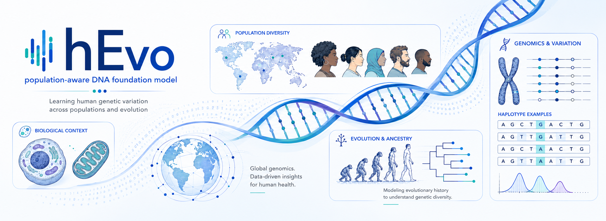

<div align="center">
  

  <h1>hEvo</h1>
  <p><strong>A Haplotype-Based DNA Foundation Model</strong></p>
  <p>Learning human genetic variation across populations and evolution.</p>

  <p>
    <a href="https://huggingface.co/MulinLab/hEvo-pretraining-code"></a>
    <a href="hEvo_benchmark/scripts/README.md"></a>
    <a href="hEvo_benchmark/README.md"></a>
    <a href="https://huggingface.co/MulinLab"></a>
  </p>

  <p>
    <a href="#getting-started">Getting started</a> &nbsp;·&nbsp;
    <a href="https://huggingface.co/MulinLab/hEvo-pretraining-code">Pretraining</a> &nbsp;·&nbsp;
    <a href="hEvo_benchmark/scripts/README.md">Benchmarks</a> &nbsp;·&nbsp;
    <a href="hEvo_benchmark/tables/repository_tables/README.md">Results</a> &nbsp;·&nbsp;
    <a href="https://huggingface.co/MulinLab">Models &amp; data</a> &nbsp;·&nbsp;
    <a href="#citation">Citation</a>
  </p>
</div>

---

## Overview

**hEvo** uses population-scale haplotype sequence variation to learn DNA representations for variant-effect scoring, regulatory annotation, and population-genetic analysis. This public repository contains benchmark evaluators, numerical source tables, and figure renderers. Pretraining and cohort preprocessing source code is hosted in a separate manually gated [Hugging Face repository](https://huggingface.co/MulinLab/hEvo-pretraining-code).

| Pretrain and calibrate | Evaluate and explore |
|---|---|
| **[hEvo pretraining and data construction](https://huggingface.co/MulinLab/hEvo-pretraining-code)** — prepare population haplotypes, train sequence representations, and calibrate nucleotide predictions. | **[hEvo benchmarks](hEvo_benchmark/README.md)** — compare models across genomic tasks, inspect results, and render figures. |

### Two stages of learning

```text
Population haplotypes
        ↓
Stage I   · Deduplicated haplotype windows → span-masked representation learning
        ↓
Stage II  · Variant-centred contexts → nucleotide prediction-head calibration
        ↓
DNA representations & REF/ALT likelihood scores
```

## Getting started

Choose a starting point for your task:

| I want to… | Open… |
|---|---|
| Find hEvo checkpoints | [hEVO-base-o](https://huggingface.co/MulinLab/hEVO-base-o) · [hEVO-large-o](https://huggingface.co/MulinLab/hEVO-large-o) |
| Browse the benchmark data bundles | [hEvo-benchmarks on Hugging Face](https://huggingface.co/datasets/MulinLab/hEvo-benchmarks) |
| Explore the numerical results | [Annotated reader tables · R01–R28](hEvo_benchmark/tables/repository_tables/README.md) |
| Run a model evaluation | [Benchmark workflows](hEvo_benchmark/scripts/README.md) |
| Generate publication figures | [Figure rendering guide](hEvo_benchmark/figures/README.md) |
| Request pretraining and dataset-construction code | [Gated HF repository](https://huggingface.co/MulinLab/hEvo-pretraining-code) |

The Hugging Face model, dataset, and pretraining-code repositories are **gated for peer review** and require manual approval by MulinLab. Sign in and request access on the relevant page before downloading or cloning. The `-o` model variants use public training data; the suffix does not indicate an open-weights license. The weight license has not yet been confirmed, and source data remain subject to their respective publication terms.

### Configure your checkout

The workflows target Linux and HPC environments. Use **Python ≥3.10** and the dependencies listed in the selected workflow guide. Model inference and training require the matching GPU runtime; table processing and figure rendering can run independently of inference.

From the repository root:

```bash
export BENCHMARK_ROOT="$PWD/hEvo_benchmark"
export MODELS_ROOT=/path/to/model-checkpoints
export MICROMAMBA_ROOT=/path/to/micromamba

micromamba -r "$MICROMAMBA_ROOT" -n llmbm run python \
  hEvo_benchmark/scripts/evaluate/probe_single_seq_input.py --help
```

Here, `llmbm` is the workflow environment name; use your configured environment if it differs. Supply model checkpoints, reference genomes, population VCFs and other large inputs through local storage paths.

| Configuration | What to set |
|---|---|
| [project.yaml](hEvo_benchmark/configs/project.yaml) | Results, caches, logs and Slurm output locations |
| [models.yaml](hEvo_benchmark/configs/models.yaml) | Model identifiers, checkpoint paths and inference settings |
| [tasks.yaml](hEvo_benchmark/configs/tasks.yaml) | Input columns, labels and task definitions |

For model-specific dependencies and input formats, follow the [configuration guide](hEvo_benchmark/configs/README.md) and the selected workflow's README.

## Models

| Scale | Primary models | Public-data variants |
|---|---|---|
| Base | `hEvo-base` | [`hEvo-open-base` / `hEVO-base-o`](https://huggingface.co/MulinLab/hEVO-base-o) |
| Large | `hEvo-large` | [`hEvo-open-large` / hEVO-large-o](https://huggingface.co/MulinLab/hEVO-large-o) |

The Hugging Face `-o` models were independently pretrained on public **1000 Genomes Project and HGDP** sequences, without target benchmark-label supervision. The HF `hEVO-base-o` file hash matches the repository's `hEvo-open-base` weights. For the large model, the HF `safetensors` file has a different file hash from the PyTorch checkpoint recorded in S47, but the HF provenance records that source-file hash and states that every tensor name and value is identical after conversion. Therefore, [`hEVO-large-o`](https://huggingface.co/MulinLab/hEVO-large-o) is the canonical published checkpoint for `hEvo-open-large`. HF weights remain gated for peer review; request access on the [hEVO-base-o](https://huggingface.co/MulinLab/hEVO-base-o) or [hEVO-large-o](https://huggingface.co/MulinLab/hEVO-large-o) page. Checkpoint locations for local workflows are configured in [models.yaml](hEvo_benchmark/configs/models.yaml).

For hEvo paired-allele scoring:

```text
LLR = log P(ALT | context) − log P(REF | context)
```

A positive LLR indicates a higher conditional likelihood for ALT. The adaptive-allele benchmark compares **selected versus other** alleles. Baseline models use model-specific native scoring definitions; see the [evaluation guide](hEvo_benchmark/scripts/evaluate/README.md) before comparing scores.

## Benchmark workflows

| Evaluation area | Tasks | Run the workflow | Source tables |
|---|---|---|---|
| **Sequence representations** | NT tasks, Genomic Benchmark, URE; ENCODE, GENCODE and RefSeq separation | [Evaluation](hEvo_benchmark/scripts/evaluate/README.md) · [Genomic elements](hEvo_benchmark/scripts/evaluation_elements/README.md) | S11–S20 |
| **Regulatory prediction** | DeepSEA multi-label prediction with LoRA | [DeepSEA](hEvo_benchmark/scripts/DeepSEA_lora/README.md) | S21 |
| **Variant effects** | ClinVar, candidate causal and rare variants, DDD, MPRA, retrospective reclassification | [Paired scoring](hEvo_benchmark/scripts/evaluate/README.md) · [ClinVar subsets](hEvo_benchmark/scripts/clinvar/README.md) | S22–S32 |
| **Ancestry** | Population embeddings, classification and ancestry-proportion regression | [Population analysis](hEvo_benchmark/scripts/population_classify/README.md) | S33–S35 |
| **Evolution and adaptation** | HAR/HAQER classification, Fig. 4e genomic tracks and adaptive-allele preference | [HAR/HAQER](hEvo_benchmark/scripts/har_haqer_workflow/README.md) · [Allele preference](hEvo_benchmark/scripts/adaptive_allele_preference_benchmark/README.md) | S36–S39; Fig. 4e source bundle |
| **Training and efficiency** | Corpus/windowing ablations, resource use, model metadata and cross-task ranks | [Evaluation](hEvo_benchmark/scripts/evaluate/README.md) · [Derived results](hEvo_benchmark/scripts/revision_consistency/README.md) | S41–S49 |

The [workflow index](hEvo_benchmark/scripts/README.md) also links cohort PCA, phasing, haplotype diversity, preprocessing and Slurm job generation.

The model checkpoints and benchmark bundles are distributed separately on [Hugging Face](https://huggingface.co/MulinLab). See the [benchmark dataset card](https://huggingface.co/datasets/MulinLab/hEvo-benchmarks) for task contents, access instructions and source-specific terms.

## Results and figures

**[R01–R28](hEvo_benchmark/tables/repository_tables/README.md)** provide annotated tables for reading and reusing results. The available **S1–S39 and S41–S50** tables contain numerical inputs and metadata used by the figure workflows; Fig. 4e tracks are provided in their dedicated source bundle.

To render the integrated figure set from local source tables:

```bash
cd "$BENCHMARK_ROOT"
micromamba -r "$MICROMAMBA_ROOT" -n llmbm run python \
  figures/scripts/run_all_figures.py \
  --tables-dir tables \
  --output-dir figures
```

The batch renderer produces **Fig. 1–5**, **FigS1–FigS7** and companion figures **FigS10–FigS13**. Each figure directory contains its integrated outputs; individual renderers also export standalone panels. See the [figure guide](hEvo_benchmark/figures/README.md) for output formats, panel commands and the publication PDF merge.

## Repository layout

```text
.
└── hEvo_benchmark/
    ├── configs/        Project, model and task settings
    ├── scripts/        Evaluation and analysis workflows
    ├── tables/         Numerical source and reader tables
    └── figures/        Figure renderers and outputs
```

Pretraining and cohort-preprocessing code is distributed from the gated [HF repository](https://huggingface.co/MulinLab/hEvo-pretraining-code). Public preprocessing result tables remain in `hEvo_benchmark/tables/preprocess_stats/`. Checkpoints, caches, logs and results use the locations selected in configuration or CLI arguments. Keep the reference genome build and model/task identifiers consistent with the chosen workflow.

## Citation

When using hEvo models, tables or figures, cite the hEvo manuscript associated with this repository, together with the original papers or releases for the models and data used in your analysis.

---

<div align="center">
  <a href="https://huggingface.co/MulinLab/hEvo-pretraining-code">Pretraining guide</a> &nbsp;·&nbsp;
  <a href="hEvo_benchmark/scripts/README.md">Workflow index</a> &nbsp;·&nbsp;
  <a href="hEvo_benchmark/tables/repository_tables/README.md">Reader tables</a> &nbsp;·&nbsp;
  <a href="https://huggingface.co/MulinLab">Hugging Face models &amp; data</a>
</div>
